<p align="center">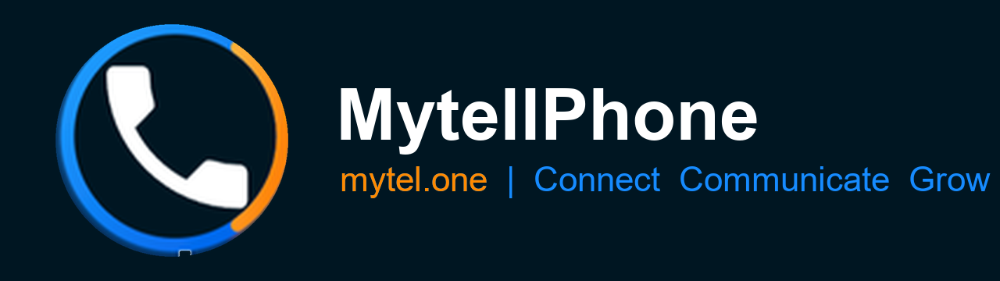</p>

# MytellPhone

Professional SIP softphone for **MyTel** ([mytel.one](https://mytel.one)) — Android edition, v2.0.0.

MytellPhone is a full-featured VoIP client: audio & video calls, multi-call management,
transfer, conference, call history, contacts, SIP over UDP/TCP/TLS, automatic server
detection, and a persistent background keep-alive service so incoming calls are never
missed — including on the lock screen, answerable without unlocking the phone.

Built on the [Linphone](https://linphone.org) engine and branded with the mytel.one
identity (navy `#001622`, blue `#0A67FF`, orange `#FF8A00`).

| | | |
|---|---|---|
| 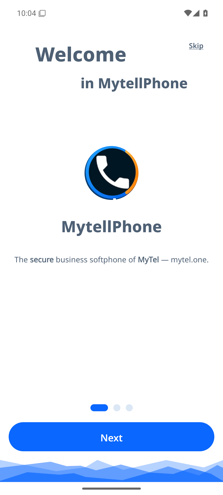 | 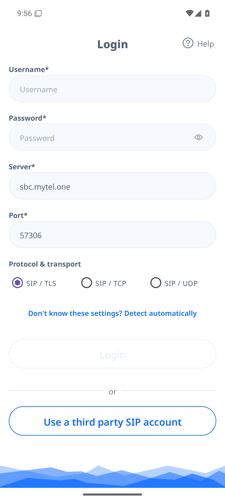 | 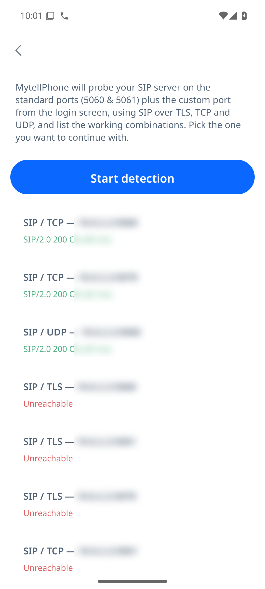 |
| 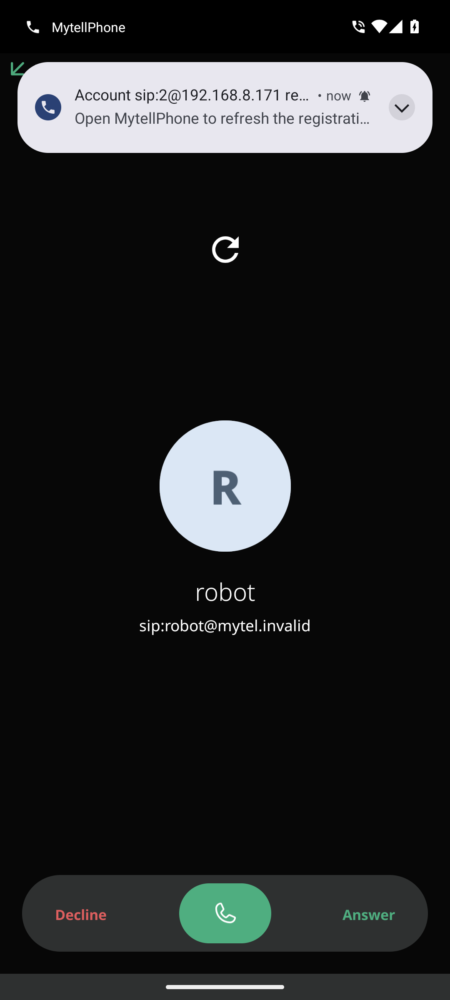 | 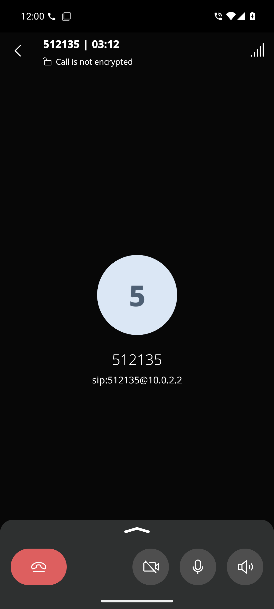 | 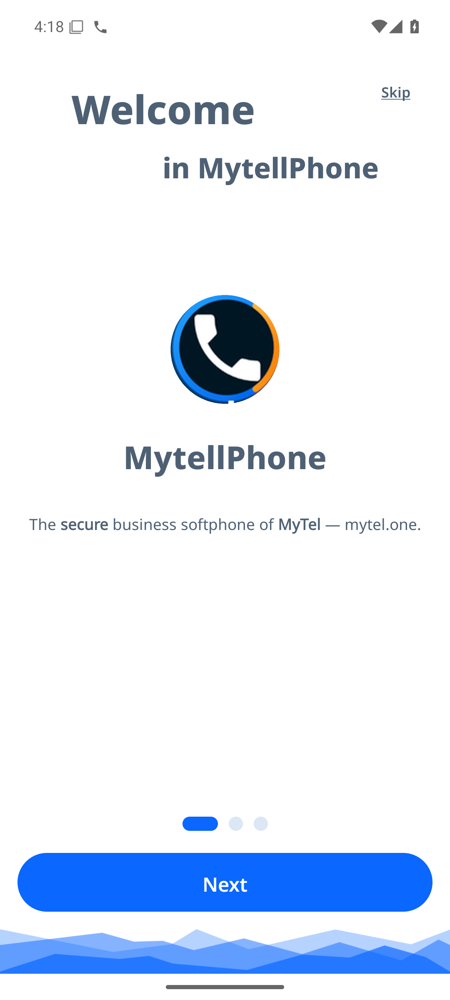 |

**Persian (فارسی)** — full RTL first-run + login: 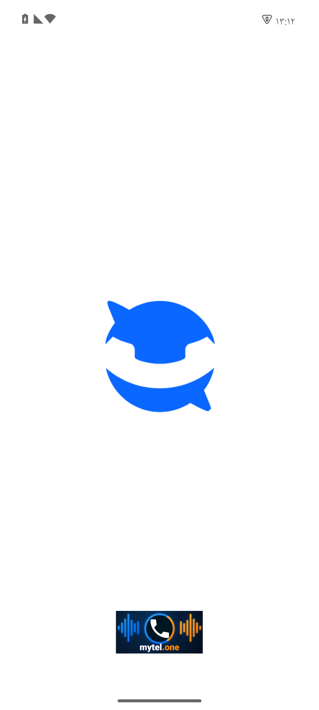 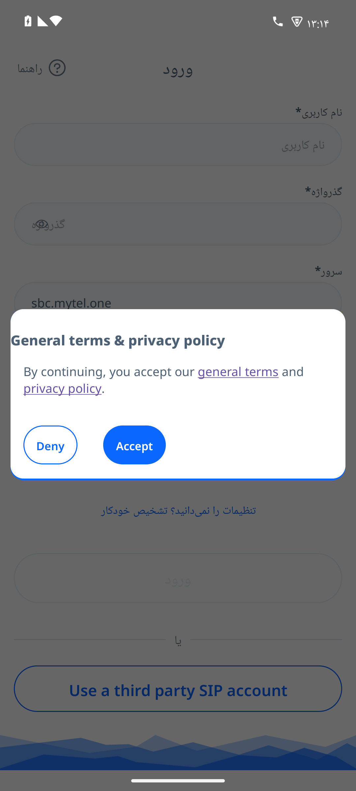 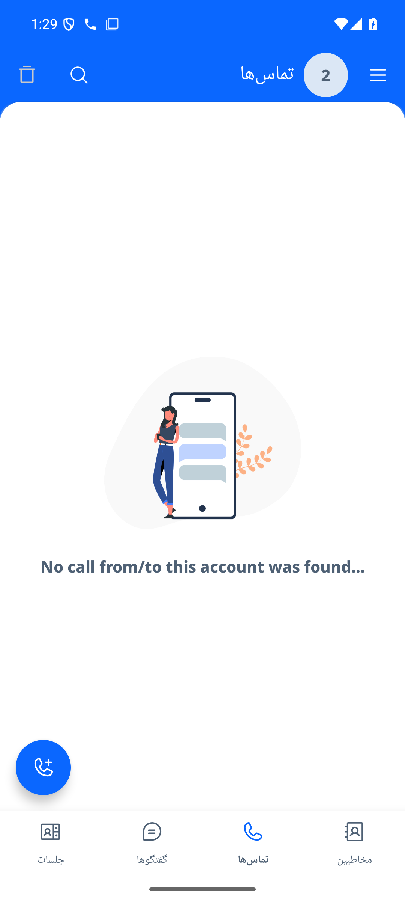

**Windows edition** (same release): 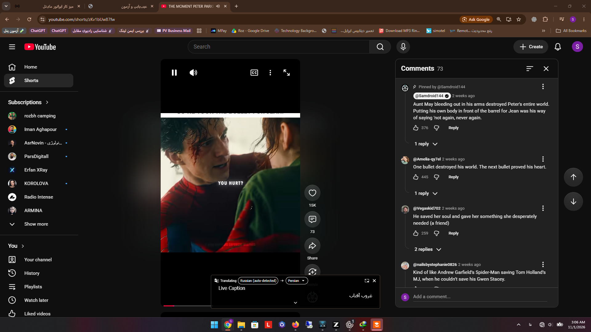 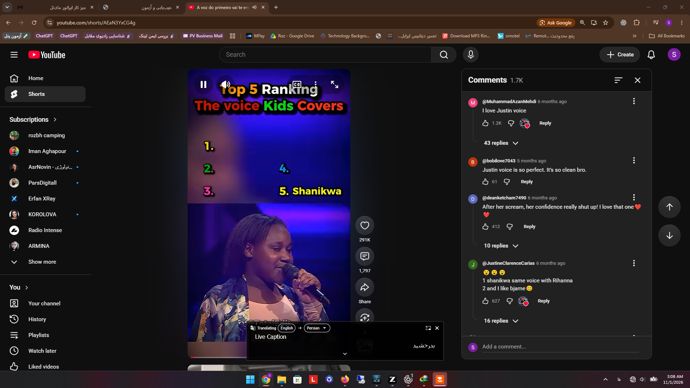

---

## Highlights (v2.0.0)

- **Login asks what a phone user actually knows**: extension, password, server address,
  port, and protocol/transport — **SIP / TLS, SIP / TCP, SIP / UDP**.
- **Automatic server detection** (Zoiper-style): one tap probes standard ports
  (5060 / 5061 + any custom port) with real SIP requests over TLS, TCP and UDP, ranks the
  working combinations (verified SIP replies only — an open TCP port alone is not enough)
  and fills the login form for you.
- **SIP User-Agent is exactly `Mytell`** — whitelisted in the MyTel firewall.
- **Never miss a call**: requests the Android *battery-optimization exemption* on first
  launch and runs a persistent keep-alive service, so registration survives in the
  background even without push notifications.
- **Lock-screen calling**: incoming calls wake the screen and can be answered without
  entering the PIN, exactly like a GSM call.
- Battery-optimization status check + request button in *Help → Debug*.

## فارسی

**مای‌تل‌فون (MytellPhone)** — نرم‌افزار تلفن سازمانی مای‌تل برای اندروید.

- صفحهٔ ورود: شمارهٔ داخلی، گذرواژه، نشانی سرور، پورت و انتخاب پروتکل — **سیپ روی TLS یا TCP یا UDP**
- **تشخیص خودکار سرور**: با یک لمس، پورت‌های استاندارد و پورت دلخواه شما با درخواست واقعی سیپ روی هر سه حمل‌ونقل آزمایش می‌شود و ترکیب‌های سالم مرتب‌شده پیشنهاد می‌شوند
- یوزرایجنت برنامه دقیقاً **Mytell** است تا در فایروال مای‌تل با همین نام مجوز بگیرد
- **همیشه در دسترس**: با مجوز معافیت از بهینه‌سازی باتری و سرویس همیشگی، ثبت‌نام در پس‌زمینه حفظ می‌شود
- **تماس روی صفحهٔ قفل**: تماس ورودی صفحه را روشن می‌کند و بدون وارد کردن رمز پاسخ داده می‌شود — مثل تماس سیم‌کارت
- طراحی و لوگو مطابق سایت [mytel.one](https://mytel.one)

برای نصب، فایل نصبی را از بخش [Releases](../../releases) دانلود و نصب کنید (اندروید ۹ به بالا).

> **Note — IAX2**: this build speaks **SIP only** (UDP/TCP/TLS). The underlying Linphone
> engine has no IAX2 stack; adding one would mean an unmaintained third-party engine.
> Any standard SIP PBX (Issabel, FreePBX, Asterisk, Kamailio…) works out of the box.

---

## Download

Grab the latest release from the [Releases](../../releases) page:

- `MytellPhone-v2.0.0.apk` — Android 9+ (arm64 / armeabi-v7a)
- `MytellPhone-v2.0.0-win64.zip` — Windows 10/11 x64 portable (unzip & run `mytellphone.exe`)

Checksums are published alongside the release assets.

## Features

- SIP account login (extension / password) — works with any standard SIP PBX/SBC,
  including `sbc.mytel.one`
- Transports: SIP over **TLS, TCP and UDP** with per-account selection
- Auto-detection of server transport/port with real SIP verification
- Audio codecs: Opus, G.722, G.711 (µ/a), SILK, AMR-WB…
- Video codecs: H.264, H.265, VP8, AV1 (device permitting)
- Multi-call, blind & attended transfer, conference, call waiting
- Contacts integration, favorites, call history, voicemail (MWI)
- Android Telecom self-managed calling, call-style notifications
- Light/dark theme following the MyTel brand colors

## Push notifications (optional)

Incoming-call push wakeup requires Firebase Cloud Messaging. To enable it, place
your own `google-services.json` in `app/` and rebuild. Without it, the app keeps a
persistent foreground registration (classic always-on SIP mode) — this is the
shipping default of v2.0.0.

## Building from source

Requirements: JDK 21, Android SDK (platform 37). The Linphone SDK is fetched
automatically from the official Belledonne maven repository (version pinned in
`gradle/libs.versions.toml`).

```bash
# one-time: create your signing config
cp keystore.properties.example keystore.properties   # then fill values + keystore

# build
./gradlew assembleRelease
# APK: app/build/outputs/apk/release/MytellPhone-release-*.apk
```

The release keystore is **not** committed. Keep `app/mytelsoftphone.keystore` and
`keystore.properties` safe — updates must be signed with the same key.

## Engineering notes (v2.0.0)

- Engine: linphone-sdk-android **5.6.0-alpha.190+026b4e9992** (pinned for reproducible builds).
- Auto-detect probe implementation: `app/src/main/java/org/linphone/utils/SipTransportScanner.kt`
- Transport selector + auto-detect UI: `ui/assistant/fragment/{LandingFragment,AutoDetectFragment}.kt`
- Keep-alive default on: `core/CorePreferences.kt` (`keep_service_alive = true`).
- Registration expires after 600 s; third-party call-quality reporting disabled.
- Stale-credential purge on repeated logins: `ui/assistant/viewmodel/AccountLoginViewModel.kt`.

## Licensing & credits

This project is a fork of [linphone-android](https://github.com/BelledonneCommunications/linphone-android)
by [Belledonne Communications](https://www.belledonne-communications.com),
licensed under the **GNU GPL v3** (see [LICENSE.txt](LICENSE.txt) and
[NOTICE.md](NOTICE.md)). The MyTel name and logo belong to mytel.one and are used
here for the MyTel product family.
