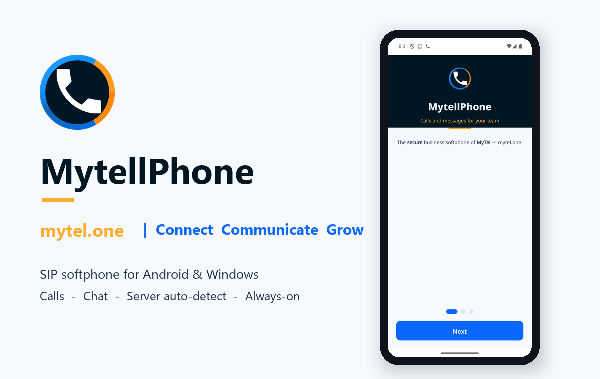

<p align="center"></p>

# MyTel 3

SIP calling and team messages for **Android and Windows**, built on the Linphone engine and the [MyTel](https://mytel.one) identity.

[Download v3.0.1](https://github.com/DashSaman/MyTelSoftPhone/releases/tag/v3.0.1) · [Verification record](docs/releases/v3.0.1/VERIFICATION.md) · [Windows build tools](release/windows/README.md)

## What changed in v3.0.1

- MyTel Windows application, notification, shortcut and installer icons; MyTel product/version metadata and a per-user installer that preserves the account profile.
- Readable Windows Transport choices in light and dark themes.
- One Android Telecom registration per live SIP call, outgoing activation and terminal cleanup.
- MyTel Android introduction with the project artwork and mytel.one link; upstream legal notices remain.

## Changes introduced in v3

- Reliable direct dialing: shared destination validation, Persian/Arabic digits, pasted phone numbers, extension dialing and explicit audio/video actions.
- Clear connection status and bounded, cancellable account setup. Late callbacks cannot complete an abandoned sign-in attempt.
- Basic SIP chat fixes: visible conversation panes, stored outgoing messages, UTF-8 text and duplicate-send protection.
- Consistent light/dark surfaces and practical layouts. Windows adds System, Light and Dark appearance choices; Android follows its appearance settings.
- Safer server directory access, bounded responses and redacted URL logs. Android excludes account and message data from system backups.
- Signed Android release enforcement, strict lint, updated CI checks, matching application source archives, license notices and SHA-256 checksums.

The release verification record distinguishes automated tests, visual review, actual PBX interoperability and checks that were not performed. Passing checks do not guarantee that every device, PBX or network condition is defect-free.

## Install

| Platform | Package | Requirement |
|---|---|---|
| Android | `MyTel-v3.0.1-android.apk` | Android 9+, ARM64 or ARMv7 |
| Windows | `MyTel-v3.0.1-windows-x64-setup.exe` or portable ZIP | Windows 10/11 x64; run the MyTel setup, or extract the portable ZIP |

Keep the existing Android installation when upgrading so its account and message data remain available. Release updates use the existing production signing key. The Windows setup installs MyTel for the current user and keeps application data. The Windows executable uses the existing application profile in `%LOCALAPPDATA%\mytellphone`; keep that directory when replacing the application folder. Windows packages include the standard x64 Microsoft C++ runtime DLLs next to the application. The supplied official `vc_redist.x64.exe` remains available for an administrator-managed runtime installation; MyTel setup does not run it automatically. The Windows binaries are not Authenticode-signed.

Enter your **extension**, **password** and **SIP server**. Transport, port and other account options are available when needed. Use **Calls** to dial, **Chats** to message an extension, and **Settings** for appearance and audio devices.

## Capabilities and PBX requirements

- SIP accounts over UDP, TCP and TLS; server transport detection.
- Audio calls, call history, contacts, hold, transfer, multi-call controls and voicemail indications through the Linphone engine.
- One-to-one text chat using SIP SIMPLE. The PBX must route SIP `MESSAGE` separately from the call dialplan. A successful server acknowledgement is not a read receipt or a guarantee of offline delivery.
- Video calling where both peers, their codecs and the PBX permit it. VP8 is available on Windows; H.264 uses the separately downloaded Cisco codec through the application's codec controls. Android video codec availability depends on the device.
- Calling external phone numbers uses the PBX's outbound routes and trunk. The application does not supply a PSTN account or change provider restrictions.
- Android foreground keep-alive and call notifications. Background reception depends on OS permissions, battery restrictions, network reachability and PBX registration; it cannot be guaranteed on every device. FCM push additionally requires an operator-configured push service.

SIP transport security and media encryption depend on your account/PBX configuration. SIP SIMPLE messages are not represented as end-to-end encrypted. This application uses SIP, not IAX2.

## فارسی

مای‌تل‌فون ۳ برای تماس و گفت‌وگوی سازمانی در اندروید و ویندوز است. برای ورود، داخلی، رمز و آدرس سرور را وارد کنید. رابط برنامه انگلیسی است و پیام فارسی پشتیبانی می‌شود. شماره‌های فارسی و قالب‌های معمول شمارهٔ ایران در شماره‌گیر پردازش می‌شوند.

برای تماس بیرونی باید مسیر خروجی و ترانک سرور تنظیم باشد. چت و تماس تصویری هم به پشتیبانی و تنظیم سرور و دستگاه مقابل نیاز دارند. جزئیات تست و محدودیت‌های همین نسخه در [گزارش بررسی](docs/releases/v3.0.1/VERIFICATION.md) آمده است.

## Build Android

Use JDK 21 and Android SDK platform 37. Dependencies and the Linphone SDK version are pinned in `gradle/libs.versions.toml`.

```sh
./gradlew testDebugUnitTest lintDebug assembleDebug
```

For a production APK, configure the existing private signing key using `keystore.properties.example`, then run:

```sh
./gradlew assembleRelease
```

Output: `app/build/outputs/apk/release/MytellPhone-release-v3.0.1.apk`. A missing production signing configuration fails release packaging; it does not silently use a debug key. Never commit signing keys or credentials.

## Source and licenses

Android source is in this repository. The v3 release also supplies the matching Windows application source and the available local Linphone SDK source snapshot, including its build patch, Qt renderer source and manifest. The SDK manifest lists unavailable external source pins; prebuilt dependency correspondence has not been independently established, and a complete offline SDK rebuild is not established. See [Windows build instructions](release/windows/README.md) for the workstation build layout and validation limits.

Application code is derived from [linphone-android](https://github.com/BelledonneCommunications/linphone-android) and [linphone-desktop](https://github.com/BelledonneCommunications/linphone-desktop), by Belledonne Communications, under GNU GPL v3 or later. SDK components retain their own GPL/AGPL and third-party notices. See [LICENSE.txt](LICENSE.txt), [NOTICE.md](NOTICE.md) and the notices supplied with release assets. MyTel names and logos belong to their owner.
